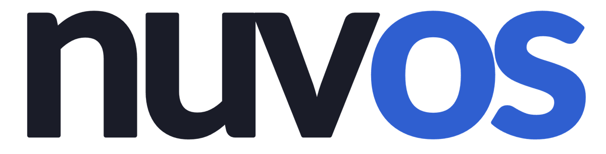
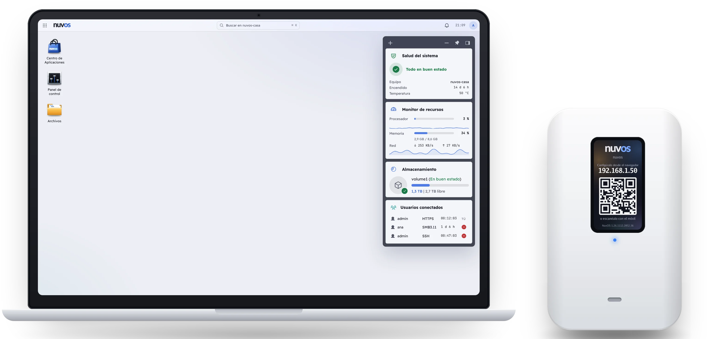
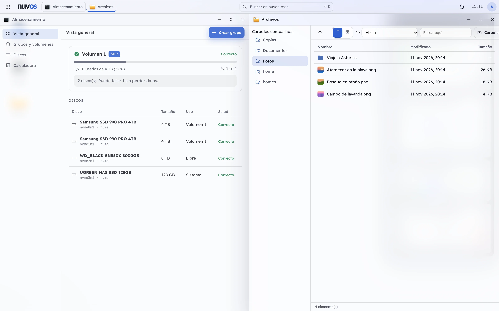
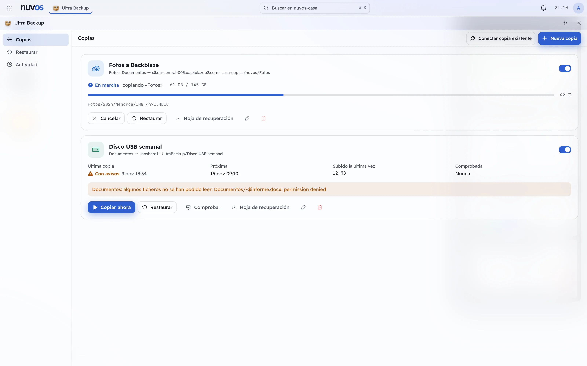
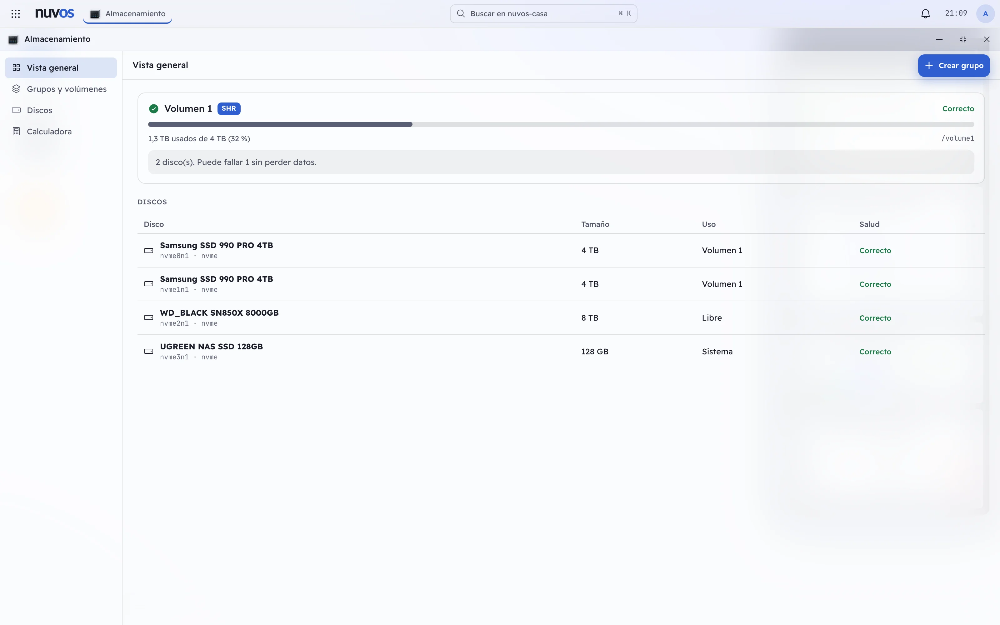
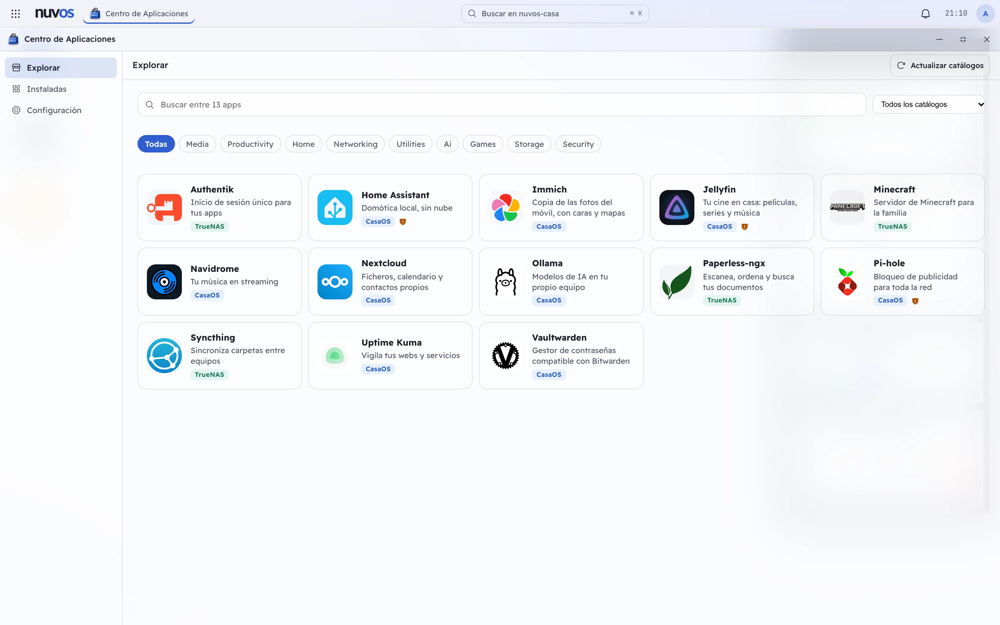
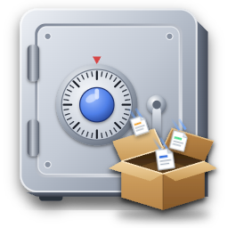
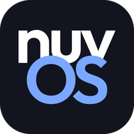

<p align="center">
  <a href="https://nuvos.link">
    <picture>
      <source media="(prefers-color-scheme: dark)" srcset=".github/assets/logo-acento-oscuro.png">
      
    </picture>
  </a>
</p>

<h3 align="center">Tu nube en casa. Un NAS bonito, sencillo y tuyo.</h3>

<p align="center">
  <a href="https://github.com/nuvolacat/nuvos-releases/releases/latest"></a>
  <a href="https://github.com/nuvolacat/nuvos-releases/releases"></a>
  <a href="https://demo.nuvos.link"></a>
</p>

<p align="center">
  <a href="https://nuvos.link"><b>Web</b></a> ·
  <a href="https://nuvos.link/descargar"><b>Descargar</b></a> ·
  <a href="https://demo.nuvos.link"><b>Demo</b></a> ·
  <a href="https://nuvos.link/releaseNote/"><b>Novedades</b></a>
</p>

<br>

<p align="center">
  <picture>
    <source media="(prefers-color-scheme: dark)" srcset=".github/assets/portada-oscuro.webp">
    
  </picture>
</p>

---

## ⬇️ Descargas

Todo está en **[Releases](https://github.com/nuvolacat/nuvos-releases/releases/latest)**. Elige según tu equipo:

| | Equipo | Qué descargar | Cómo se instala |
|:-:|---|---|---|
| 💿 | **PC o NAS x86-64** | `nuvos_<versión>.raw.xz` | Grábala en una memoria USB con [balenaEtcher](https://etcher.balena.io) o [Raspberry Pi Imager](https://www.raspberrypi.com/software/) y arranca desde ella. |
| 🗄️ | **UniFi UNAS** | — | Desde el navegador, en **[nuvos.link/unifi](https://nuvos.link/unifi/)**, viendo cada orden que se ejecuta. |
| 🔐 | **Synology (NuvOS Vault)** | `NuvOSVault.spk` | Centro de paquetes › Instalación manual. Guarda las copias de Ultra Backup sin SSH ni SFTP. |
| 📱 | **App eXploratore** | — | iOS y Android. *Próximamente.* |

> [!TIP]
> Comprueba la descarga antes de grabarla:
> ```sh
> shasum -a 256 -c SHA256SUMS
> ```

> [!NOTE]
> **UniFi UNAS:** en teoría NuvOS funciona en todos los UNAS, pero de momento solo está verificado en el **UNAS 2** y el **UNAS Pro**. El instalador revisa el modelo y no toca un equipo que no se haya probado.

---

## ✨ Qué trae

<table>
  <tr>
    <td width="50%" valign="top">
      <h3>🗂️ Carpetas para todos</h3>
      Carpetas compartidas para Windows, Mac y Linux, con usuarios, grupos y permisos claros. Instantáneas y carpetas cifradas.
    </td>
    <td width="50%" valign="top">
      <h3>🛟 Ultra Backup</h3>
      Copias cifradas y versionadas a otro disco, a la nube o a un Synology con <b>NuvOS Vault</b>. Protegidas contra ransomware: nada se sobrescribe.
    </td>
  </tr>
  <tr>
    <td width="50%" valign="top">
      <h3>🧩 Centro de aplicaciones</h3>
      Instala apps con un clic y ábrelas desde el escritorio, como en un ordenador.
    </td>
    <td width="50%" valign="top">
      <h3>🌍 Acceso desde fuera</h3>
      Con <b>NuvID</b> tienes una dirección propia para entrar desde cualquier sitio, sin abrir puertos en el router.
    </td>
  </tr>
  <tr>
    <td width="50%" valign="top">
      <h3>🔄 Actualizaciones firmadas</h3>
      Cada versión va firmada y se instala en la copia del sistema que no usas. Si no arranca bien, el NAS vuelve solo a la anterior.
    </td>
    <td width="50%" valign="top">
      <h3>🎨 Bonito de verdad</h3>
      Escritorio en el navegador, modo claro y oscuro, y pensado para que no haga falta leer un manual.
    </td>
  </tr>
</table>

---

## 📸 Capturas

<table>
  <tr>
    <td><picture><source media="(prefers-color-scheme: dark)" srcset=".github/assets/escritorio-ventanas-oscuro.webp"></picture></td>
    <td><picture><source media="(prefers-color-scheme: dark)" srcset=".github/assets/ultra-backup-oscuro.webp"></picture></td>
  </tr>
  <tr>
    <td align="center"><sub>Escritorio</sub></td>
    <td align="center"><sub>Ultra Backup</sub></td>
  </tr>
  <tr>
    <td><picture><source media="(prefers-color-scheme: dark)" srcset=".github/assets/almacenamiento-oscuro.webp"></picture></td>
    <td><picture><source media="(prefers-color-scheme: dark)" srcset=".github/assets/centro-aplicaciones-oscuro.webp"></picture></td>
  </tr>
  <tr>
    <td align="center"><sub>Almacenamiento</sub></td>
    <td align="center"><sub>Centro de aplicaciones</sub></td>
  </tr>
</table>

---

## 🔐 NuvOS Vault para Synology



Convierte un Synology en destino de copias de **Ultra Backup**, al estilo de Hyper Backup Vault. Se empareja con un código de 12 letras, cada NuvOS tiene su propia carpeta y lo que se borra pasa antes por una papelera.

Instálalo desde el Centro de paquetes con `NuvOSVault.spk` (DSM 7).

<br clear="left">

---

## ❓ Preguntas

<details>
<summary><b>¿Dónde está el código?</b></summary>
<br>
Este repositorio es solo para las descargas. El código de NuvOS no es público.
</details>

<details>
<summary><b>¿Cómo actualizo?</b></summary>
<br>
No hace falta volver a descargar nada: NuvOS se actualiza solo desde el propio sistema. Estas imágenes son para instalarlo por primera vez.
</details>

<details>
<summary><b>¿Hay que pagar?</b></summary>
<br>
No. NuvOS es gratis y no necesita cuenta.
</details>

<details>
<summary><b>Encontré un problema</b></summary>
<br>
Escríbenos a <a href="mailto:hola@nuvos.link">hola@nuvos.link</a>.
</details>

---

<p align="center">
  <br>
  <sub>© NUVOLACAT · <a href="https://nuvos.link/legal/">Aviso legal</a></sub><br>
  <sub>UniFi y UNAS son marcas de Ubiquiti Inc.; Synology y Hyper Backup son marcas de Synology Inc. NuvOS es un proyecto independiente sin relación con ellas.</sub>
</p>
